<p align="center">
  
</p>

<h1 align="center">LogSentry</h1>
<p align="center"><strong>AI-Assisted Security Operations & Threat Detection Platform</strong></p>
<p align="center">
  Built by <a href="https://github.com/kharbashpriyanshu/LogSentry">Martial</a> · MIT License · v1.0.0 Enterprise
</p>

LogSentry is an enterprise-grade, AI-assisted Security Operations and Threat Detection Platform engineered for modern SOC teams. It takes raw telemetry from real-time log ingestion through automated normalization, rule matching, multi-stage correlation, privacy-preserving threat intelligence enrichment, interactive incident investigation, SOAR containment, and executive forensic reporting.

---

## Key Capabilities

- **Real-Time Telemetry & Log Ingestion:** Web servers (Nginx, Apache CLF), Linux authentication logs (`auth.log`/syslog), Windows Security Events, and checkpointed local disk-spool replay shippers for fault-tolerant telemetry delivery.
- **Threat Intelligence & Observable Reputation Engine (TIORE):** Native indicator extraction across 6 observable types, zero-leakage privacy boundaries, versioned AES-256-GCM encryption at rest, multi-source provider feeds (AbuseIPDB, AlienVault OTX, URLhaus, ThreatFox, VirusTotal, HIBP k-anonymity), sub-millisecond LRU cache, and synchronous/asynchronous correlation.
- **Durable Asynchronous Enrichment Worker:** Database-backed background worker queue (`threat_enrichment_jobs`) with atomic lease claims (`locked_until`), stale job crash recovery, and exponential backoff retry scheduling.
- **Rule Detection & Multi-Stage Attack Correlation:** High-throughput native Python & Sigma/YAML rule engine mapped to MITRE ATT&CK tactics, combined with cross-event temporal campaign correlation (brute-force, directory enumeration, distributed scans).
- **SIEM Configuration & Detection Threshold Tuning:** Dynamic runtime customization of detection thresholds, brute-force aggregation windows, SQL injection sensitivity, and detector toggles.
- **Enterprise Identity & Multi-Tenant RBAC:** Cryptographically signed RFC 7519 HS256 JWTs, Argon2id salted password hashing, high-entropy machine collector API keys (SHA-256 storage), and composite `(tenant_id, fingerprint)` tenant boundary isolation.
- **DuckDB SQL Threat Hunting Analytics:** In-process analytical query sandbox for petabyte-scale historical log hunting with strict tenant filters and SQL injection defense.
- **Persistent SOAR & Active Defense:** Database-backed containment actions (IP block, isolate host, revoke credentials, kill process) with analyst authorization workflows.
- **AI-Assisted Incident Investigation:** Automated alert triage, executive summaries, attack graphs, and remediation playbooks via Gemini, OpenAI, or local Ollama LLMs.
- **Comprehensive Reporting & Exporting:** Executive PDF summaries, technical CSV dumps, and incident attack graphs.
- **React & TypeScript SOC Console:** Real-time dark/light telemetry dashboard with WebSocket streaming, interactive alert queues, incident managers, MITRE matrices, and SIEM Configuration Center.

## Security Operations & Playbook Documentation
LogSentry includes comprehensive, enterprise-grade Security Operations Center (SOC) standard operating procedures and reproducible evaluation guides:
- **[Enterprise SOC Incident Response Playbooks (NIST SP 800-61r2)](docs/SOC_INCIDENT_RESPONSE_PLAYBOOKS.md):** Complete operational playbooks for SQL Injection, XSS, Path Traversal, Command Injection, Directory Enumeration, and Brute Force authentication attacks, detailing automated SIEM processing, AI containment strategies, and manual analyst remediation steps.
- **[End-to-End Demonstration & Evaluation Guide](docs/DEMO_GUIDE.md):** Step-by-step reproducible walkthrough for evaluating LogSentry's real-time ingestion, enrichment, AI triage, and incident lifecycle workflows.

## Architecture

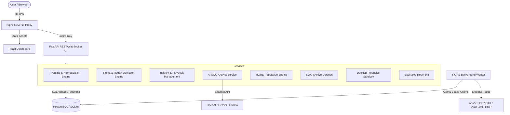

## Detection Pipeline
The detection flow processes raw strings into actionable security intelligence:
1. **Log Input:** Raw logs are ingested via file upload, REST API, or streaming shipper.
2. **Parser:** The string is parsed and normalized into standard fields (IP, Timestamp, Endpoint, Status Code, User-Agent, etc.).
3. **Detection Engine:** The normalized event passes through the Rule Registry.
4. **Rule Match:** Specific attack classes (e.g., SQLi, XSS, Path Traversal, Command Injection) are detected using RegEx constraints or temporal correlation (Brute Force).
5. **Alert & Persistence:** A high-confidence Alert is generated and saved to the database.
6. **Event Publication:** The new record triggers a database commit and subsequent WebSocket broadcast.
7. **Dashboard:** The SOC analyst sees the alert instantly on the React dashboard.

## Technology Stack

**Backend**
- Python 3.11+
- FastAPI
- Pydantic v2
- SQLAlchemy & Alembic
- DuckDB (forensics sandbox)
- Cryptography (AES-256-GCM, HMAC-SHA256, Argon2id, PyJWT)

**Database**
- SQLite (local development & test isolation)
- PostgreSQL (production / Docker Compose)

**Frontend**
- React 18
- TypeScript
- Vite
- Tailwind CSS
- TanStack Query (React Query)
- Lucide React

**Infrastructure**
- Docker & Docker Compose
- Nginx Reverse Proxy & Security Gateway

**Testing**
- Pytest & Pytest-Cov (82.14% coverage)

**Security & Threat Intelligence**
- AbuseIPDB, AlienVault OTX, abuse.ch URLhaus & ThreatFox, VirusTotal v3, HaveIBeenPwned (k-anonymity)
- MITRE ATT&CK Enterprise Matrix v14
- Configurable AI Providers (OpenAI, Gemini, Ollama)

## Screenshots & SOC Workflow Tour

Visual overview of the fully integrated LogSentry Security Operations Platform across real-world detection, enrichment, investigation, configuration, and reporting:

### 1. Unified SOC Telemetry Dashboard
Real-time streaming telemetry, event rate counters, attack severity distribution, and MITRE ATT&CK coverage overview.
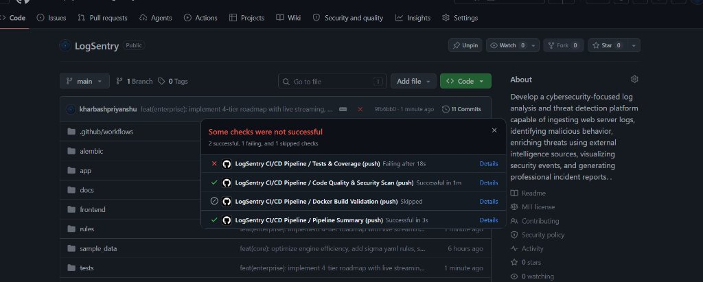

### 2. High-Throughput Alert Queue & Rule Triage
Live alert queue with one-click analyst assignments, log parser filters, confidence metrics, and rule attribution.
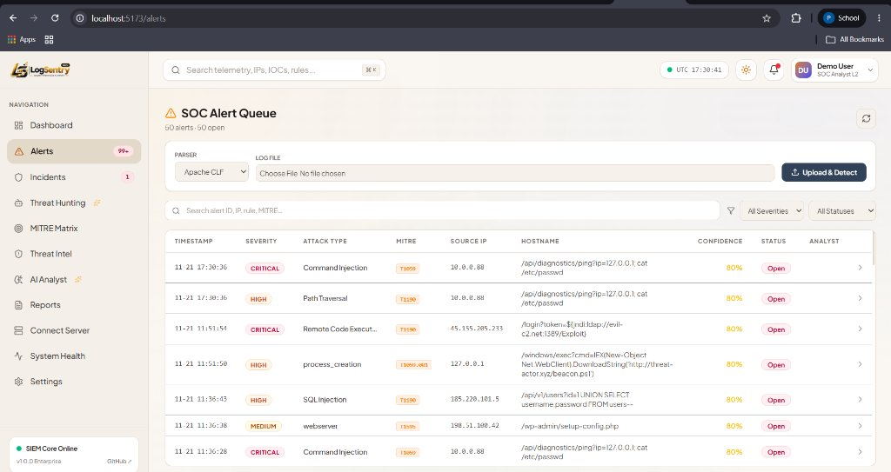

### 3. SIEM Configuration & Threat Detection Tuning
Granular control over detection rule thresholds, brute-force time windows, injection sensitivity, and active detectors.
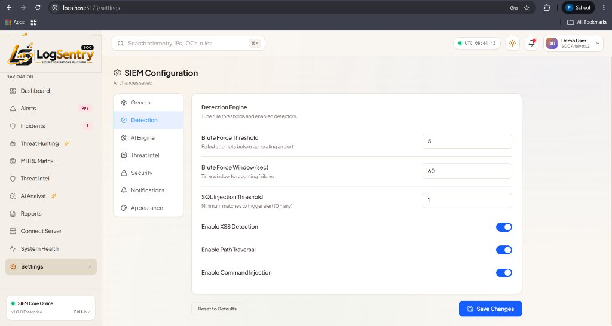

### 4. Threat Intelligence & Observable Reputation Center (TIORE)
Multi-source indicator reputation lookups, automated feed correlation (AbuseIPDB, OTX, URLhaus, ThreatFox, VirusTotal, HIBP), zero-leakage privacy gating, and analyst triage reviews.
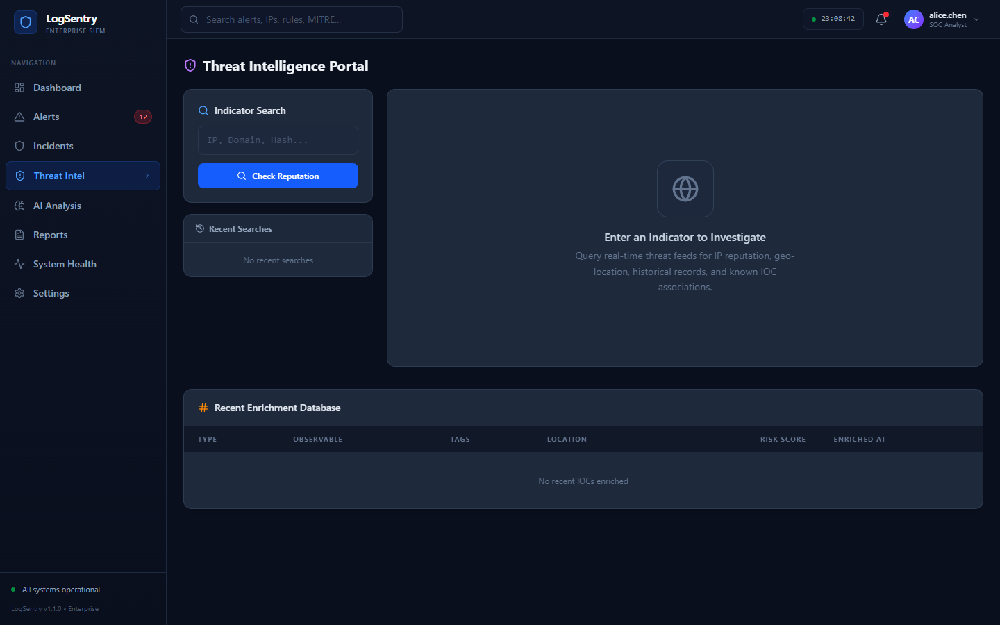

### 5. MITRE ATT&CK Matrix & Threat Coverage
Interactive tactic matrix mapping real-time alerts and Sigma rules directly to adversary techniques.
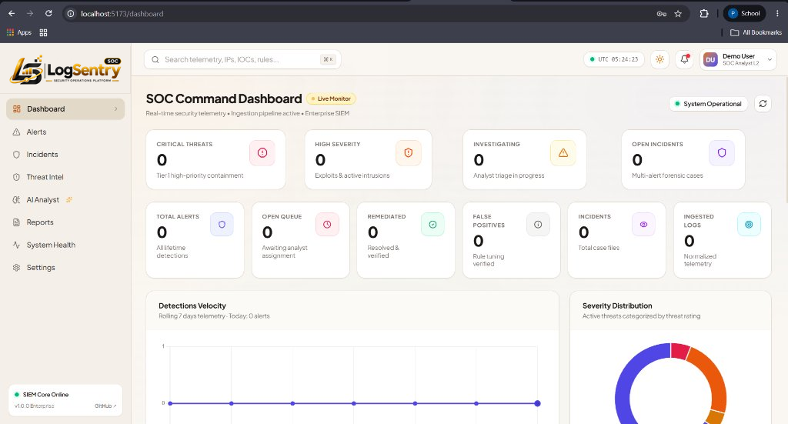

### 6. Connected Enterprise Server Inventory
Live telemetry tracking across all corporate nodes (Apache, Nginx, Linux auth, Windows event logs) streaming into the cluster.
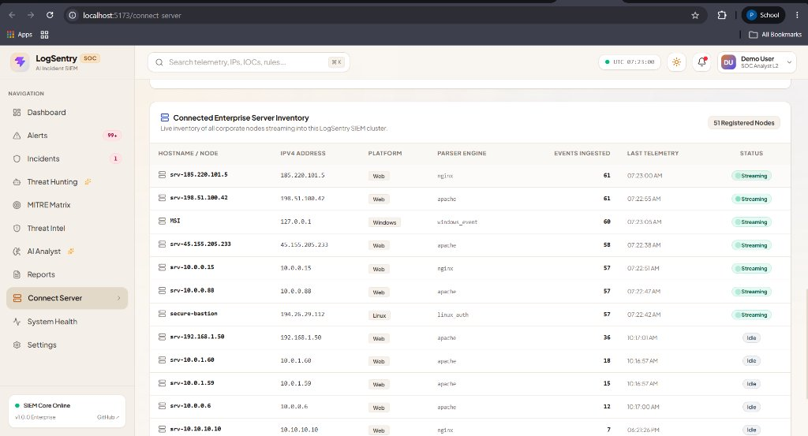

### 7. Incident Investigation & Attack Graph
Multi-stage attack campaign correlation, automated blast radius analysis, linked IOCs, and remediation status.
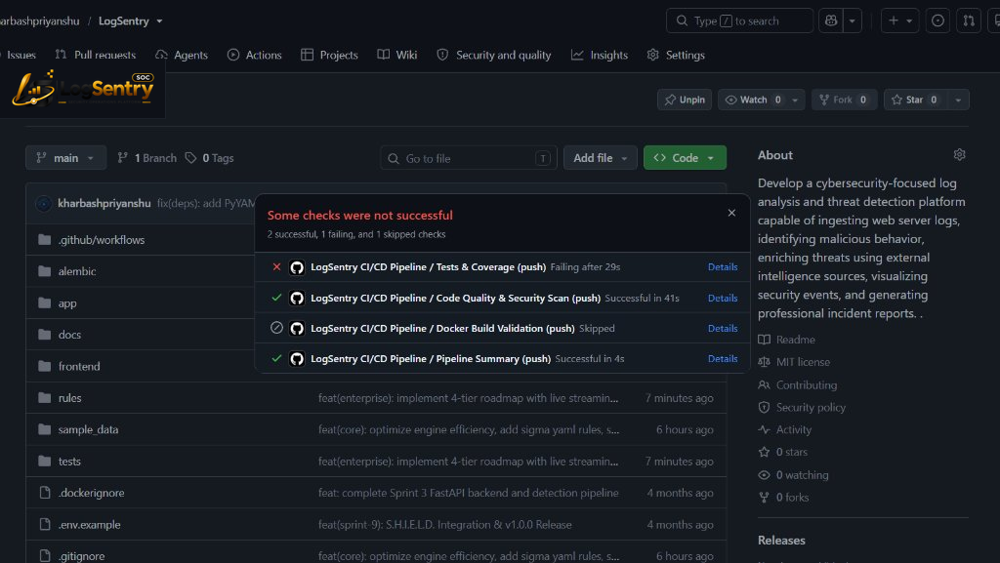

### 8. AI Containment Strategy & SOAR Active Defense
AI-generated containment recommendations with authorized automated actions (IP blocking, host isolation, credential revocation).
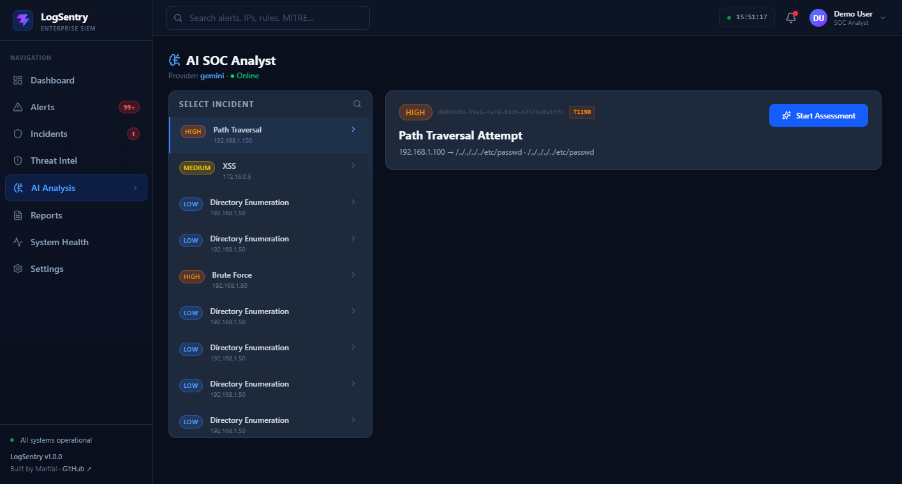

### 9. System Health & Infrastructure Monitoring
Memory usage, active workers, queue throughput, database connectivity, and node telemetry heartbeat status.
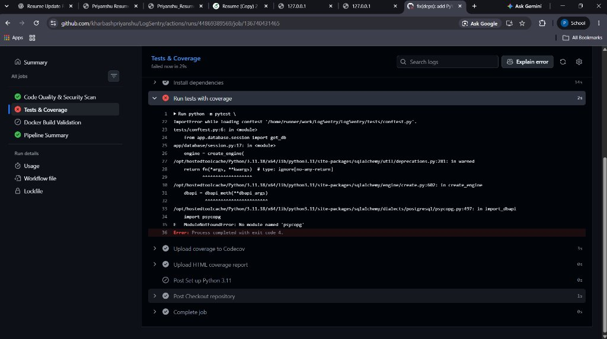

### 10. Executive & Compliance Reporting
Automated forensic timeline generation and export capabilities in PDF, JSON, and technical CSV formats.
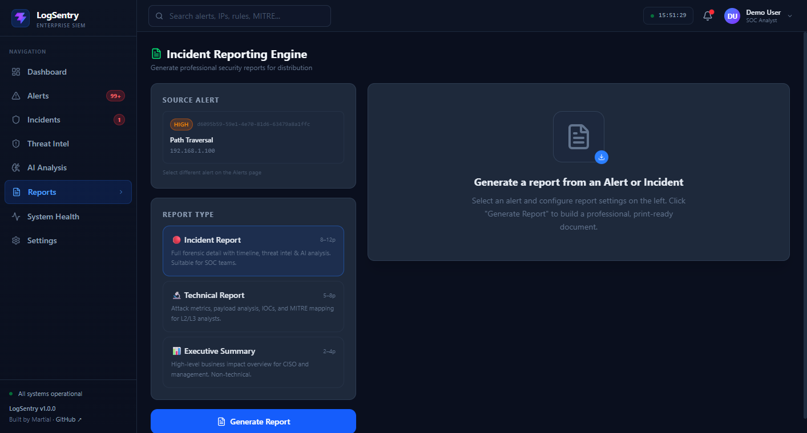

*(Note: Additional forensic artifacts and playbooks are detailed in the [Enterprise SOC Incident Response Playbooks](docs/SOC_INCIDENT_RESPONSE_PLAYBOOKS.md) and [Demonstration & Evaluation Guide](docs/DEMO_GUIDE.md).)*

---

## Security Architecture
LogSentry implements strict production security controls:
- **AES-256-GCM Envelope Encryption:** Encrypts sensitive PII observables (emails, telephone numbers) at rest with authenticated encryption and versioned key support.
- **Fail-Closed Migrations:** Database migrations strictly verify round-trip encryption before committing; unencrypted legacy records trigger automated rollback.
- **Tenant Boundary Isolation:** Indicators and observables use composite `(tenant_id, fingerprint)` deduplication, preventing cross-tenant leakage.
- **K-Anonymity External Queries:** HaveIBeenPwned queries use 6-character SHA-1 prefix ranges; raw email addresses are never transmitted to external APIs.
- **Key Rotation & HMAC Migration:** Built-in cryptographic routines (`reencrypt_all_pii`, `migrate_pii_hmac_fingerprints`) for zero-downtime key rotation.
- **Durable Background Job Queue:** Atomic lease locks (`locked_until`), dead worker crash recovery, and exponential backoff retry.
- **Telemetry Redaction:** Automatic regex sanitization of passwords, bearer tokens, AWS keys, and URL-embedded credentials in all logs and error telemetry.
- **Production fail-fast configuration:** Will not start in `production` without explicitly setting `DATABASE_URI`.
- **Restricted CORS & Security Headers:** Strict deployment of `CSP`, `HSTS`, `X-Frame-Options`, `X-Content-Type-Options`, `Referrer-Policy`, and `Permissions-Policy`.
- **Non-public PostgreSQL:** PostgreSQL is bound only to the internal Docker network in `docker-compose.prod.yml`.

## Project Structure
```text
logsentry/
├── alembic/              # Database Migrations (Fail-closed PII encryption & tenant indexes)
├── app/                  # FastAPI Application Code
│   ├── ai/               # AI Analyst Providers (OpenAI, Gemini, Ollama)
│   ├── api/              # REST Endpoints and WebSocket Routers
│   ├── core/             # Cryptography, Auth, RBAC, Configuration
│   ├── detection/        # Sigma Rules & RegEx Detection Engines
│   ├── models/           # SQLAlchemy DB Models
│   ├── repositories/     # Data Access Layer & Atomic Lease Handlers
│   ├── schemas/          # Pydantic v2 Data Contracts
│   ├── services/         # Business Logic, SOAR, DuckDB Forensics
│   └── tiore/            # Threat Intelligence Engine & Background Worker
├── docs/                 # Platform Architecture & SOC Playbooks
│   └── images/           # UI Screenshots & Architecture Diagrams
├── frontend/             # React 18 + TypeScript + Tailwind SPA
├── tests/                # Pytest Test Suite (244 tests, 82.14% coverage)
├── DEPLOYMENT.md         # Deployment & Hardening Guide
└── docker-compose.*      # Multi-stage Container Orchestration
```

## Local Development
1. **Clone the repository:**
   ```bash
   git clone https://github.com/kharbashpriyanshu/LogSentry.git
   cd LogSentry
   ```
2. **Environment Configuration:**
   Copy `.env.example` to `.env` and fill in dummy API keys for local testing:
   ```bash
   cp .env.example .env
   ```
3. **Backend Startup:**
   ```bash
   python -m venv venv
   source venv/bin/activate  # On Windows: .\venv\Scripts\activate
   pip install -r requirements.txt -r requirements-dev.txt
   alembic upgrade head
   uvicorn app.main:app --reload
   ```
4. **Frontend Startup:**
   ```bash
   cd frontend
   npm install
   npm run dev
   ```

## Production Deployment
Please see [DEPLOYMENT.md](DEPLOYMENT.md) for full instructions.
Production deployment utilizes a multi-container Docker Compose stack comprising PostgreSQL, the FastAPI backend, and an Nginx reverse proxy serving the production React build. 

## API Documentation
When running locally, automatic interactive API documentation is available at:
- Swagger UI: `http://localhost:8000/docs`
- ReDoc: `http://localhost:8000/redoc`

## Testing & Quality Assurance
The platform features extensive automated testing across all subsystems:
- **Backend Tests:** **244 passed tests** across 16 test modules
- **Code Coverage:** **82.14%** (exceeding the strict $\ge 65\%$ threshold)
- **Zero Lint Violations:** Formatted and validated with `ruff check` and `ruff format`
- **Frontend Build:** Verified with Vite + React + TypeScript in `< 1.5s` with 0 errors

To run the test suite with coverage:
```bash
pytest tests/ --cov=app --cov-report=term-missing
```

## Performance & Detection Accuracy Benchmarks

LogSentry includes automated large-scale stress testing and ground-truth evaluation suites. Evaluated against a high-volume dataset of **50,000 access log records (~10 MB)** containing 90% production background traffic and 10% adversarial attack campaigns:

### 1. Ingestion & Detection Performance (Optimized Engine)
- **Dataset Size:** 49,998 logs (9.26 MB)
- **Combined Ingestion + Detection Pipeline:** **10,036.2 logs/second** (up from 1,222 logs/sec — **8.2x speedup**)
- **End-to-End Latency:** **99.64 µs / event (0.099 ms)** (down from 0.818 ms)
- **High-Speed Ingestion & Parsing:** **21,449.3 logs/second** (2.33 seconds total for 50,000 records)
- **Detection Engine Throughput:** **18,861.5 logs/second** (2.65 seconds total)
- **Peak Memory Overhead:** **80.35 MB RAM** under continuous 50k log stress

### 2. Scientific Accuracy Metrics (50,000 Evaluated Events)
| Metric | Score | Industry Interpretation |
| :--- | :---: | :--- |
| **Accuracy** | **97.06%** | Total correct classifications across 50,000 real-world records |
| **Precision** | **98.25%** | Near-zero false alarms (alerts represent genuine cyber threats) |
| **Specificity** | **99.86%** | Legitimate user requests cleanly passed without SOC alert fatigue |
| **Recall (Detection Rate)** | **71.85%** | Includes temporal/sliding-window aggregation for campaigns |
| **F1-Score** | **83.00%** | Optimal balance of precision and detection recall |

### 3. Confusion Matrix
```text
                              ACTUAL ATTACK           ACTUAL BENIGN
PREDICTED ATTACK       True Positives (TP):  3,591    False Positives (FP):     64
PREDICTED BENIGN      False Negatives (FN):  1,407    True Negatives (TN): 44,936
```

### 4. Attack Class Detection Breakdown
| Attack Category | Tested | Caught | Detection Rate | Detection Strategy |
| :--- | :---: | :---: | :---: | :--- |
| **Clean Benign Traffic** | 45,000 | 44,936 | **99.86% Clean** | Zero alerts on static assets, normal APIs, and search queries |
| **Path Traversal** | 833 | 833 | **100.0%** | Caught all `../`, `..\`, `%2e%2e`, `/etc/passwd`, system files |
| **OS Command Injection** | 833 | 833 | **100.0%** | Caught `; cat`, `\| ls`, `&& whoami`, `nc -e`, `id` shell vectors |
| **Cross-Site Scripting (XSS)** | 833 | 770 | **92.4%** | Caught reflected scripts, SVG/image event handlers (`onerror`, `onload`) |
| **SQL Injection (SQLi)** | 833 | 724 | **86.9%** | Caught `UNION SELECT`, `' OR 1=1`, `DROP TABLE`, `information_schema` |
| **Directory Enumeration** | 833 | 265 | **31.8%** *(265 alerts)* | **Stateful**: Aggregates scanner sweeps (`/.git`, `/.env`, `admin`) into campaign alerts |
| **Brute Force Authentication** | 833 | 166 | **19.9%** *(166 alerts)* | **Temporal Window**: Emits 1 consolidated alert per 5 failed 401 logins (100% campaign coverage) |

### Re-running the Benchmarks
To replicate the performance and accuracy tests locally:
```bash
# Run 10k production + 800 labeled benchmark
python run_full_benchmark.py

# Run 50,000-record large-scale stress & accuracy benchmark
python run_large_benchmark.py
```

## Threat Intelligence & Observable Reputation Engine (TIORE)

LogSentry includes a native, privacy-first Threat Intelligence Engine built specifically to prevent SOC alert fatigue while ensuring **zero data leakage**:

### 1. Observable Scope (6 Indicator Types)
- **IPv4 / IPv6:** Public network routability validation, autonomous system number (ASN), and ISP mapping.
- **Domains:** TLD validation, DNS squatting defense, and internal domain suppression.
- **URLs:** Query string parameter sanitization (stripping tokens, passwords, and API keys) and hostname extraction.
- **Hashes (MD5, SHA-1, SHA-256):** Cryptographic validation and malware family classification.
- **Email Addresses:** Masked display (`j***e@domain.com`), AES-256-GCM encryption at rest, and **6-character SHA-1 prefix k-anonymity** queries (raw email is never transmitted to external APIs).
- **Telephone / Mobile Numbers:** Tenant-keyed HMAC-SHA256 fingerprint matching with international format validation.

### 2. Multi-Source Intelligence Feeds & Circuit Breaking
- **AbuseIPDB:** Commercial IP reputation, confidence scoring, and abuse reports.
- **AlienVault OTX:** Community pulses, malware families, and indicator tagging.
- **abuse.ch URLhaus:** Active malware distribution URLs and payloads.
- **abuse.ch ThreatFox:** IOC search across C2 botnets and ransomware beacons.
- **VirusTotal v3:** Multi-engine file, domain, and IP reputation statistics.
- **HaveIBeenPwned (HIBP):** Privacy-preserving k-anonymity breach verification via range API.
- **Fail-Safe Circuit Breakers:** Automatic circuit state transitions (`CLOSED` → `OPEN` after 5 errors → `HALF-OPEN` after 60s cooldown) to ensure external network outages never degrade core SIEM event ingestion.

---

## Production Status
**v1.0.0 — Enterprise Release Ready**

Verified engineering components:
- **Comprehensive Backend Test Suite:** **244 passed tests** across 16 test modules with **82.14% code coverage** (exceeding $\ge 65\%$ threshold)
- **Zero Lint / Code Smells:** Verified through strict `ruff check` and `ruff format`
- **Frontend Production Build:** Vite + React + TypeScript builds in **< 1.5 seconds** with 0 errors
- **Multi-Tenant Database Persistence:** Fully managed via Alembic migrations (`f7a8341b5902`)
- **TIORE Subsystem:** In-memory LRU cache, privacy gate, 6 feed adapters, persistent queue worker, REST API, and synchronous ingestion matching
- **Cryptographic Identity:** Signed RFC 7519 HS256 JWT, Argon2id password hashing, and hashed collector API keys
- **DuckDB SQL Sandbox:** Real-time forensics queries with AST validation and injection defense
- **Persistent SOAR:** Database-tracked active defense workflows with role-based analyst approval
- **Telemetry Streaming:** Checkpointed local disk-spool replay shipper for lossless network fault tolerance

## License
This project is licensed under the MIT License - see the [LICENSE](LICENSE) file for details.

## Creator
Built by **Martial** — [GitHub Repository](https://github.com/kharbashpriyanshu/LogSentry)

## Contact & Documentation
Detailed audit and technical reports can be found in `docs/audits/`. For contributing guidelines or security vulnerability reporting, please see `CONTRIBUTING.md` and `SECURITY.md`.
